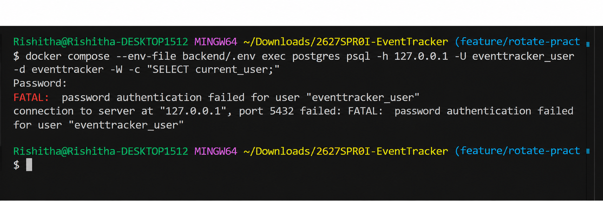
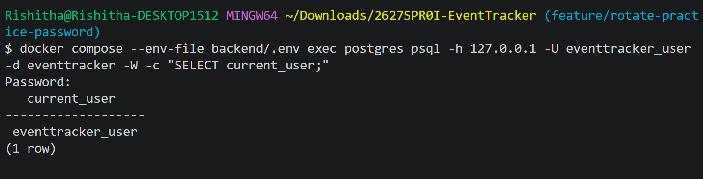
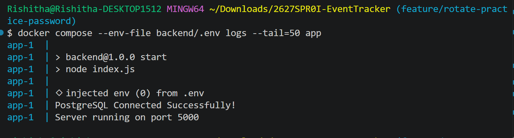

# Practice Database Password Rotation

## Target database

- Database: `eventtracker`
- Database role: `eventtracker_user`
- Environment: Local Docker Compose practice database
- PostgreSQL version: 17

The rotation was performed against the local practice database, not the showcase database.

## Procedure

1. Confirmed the database identity and PostgreSQL version.
2. Changed the `eventtracker_user` password inside PostgreSQL using the interactive `\password` command.
3. Updated `POSTGRES_PASSWORD` in the local `backend/.env` secret store.
4. Verified that `backend/.env` is excluded from Git.
5. Tested authentication using the previous password.
6. Tested authentication using the replacement password.
7. Recreated the application container to load the updated environment.
8. Checked application logs and tested the service.

## Verification results

- Old password authentication: 
- New password authentication: 
- Application recovery: 

## Security precautions

- No database passwords are stored in this document.
- No passwords are committed to Git.
- The existing PostgreSQL data volume was preserved.
- The showcase database was not modified.